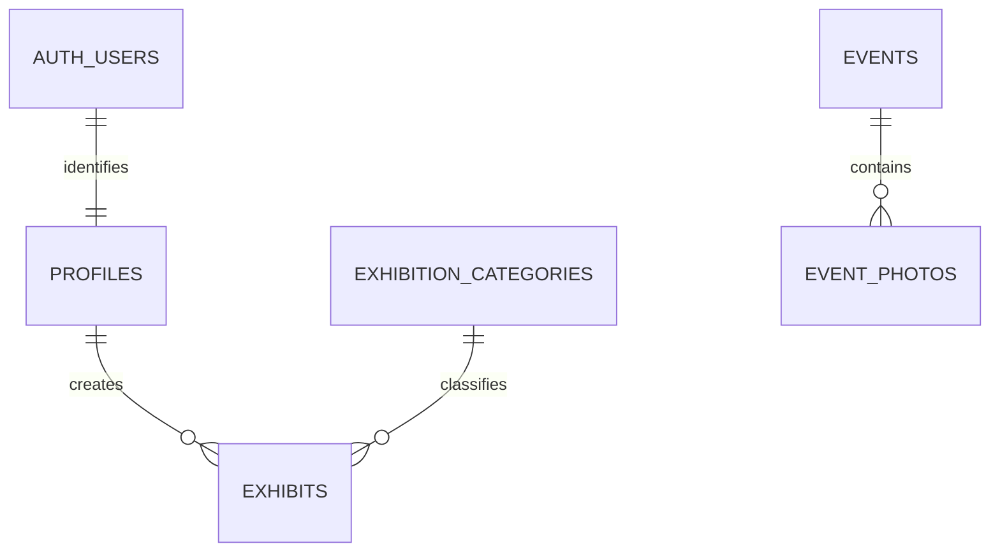

# Architecture and database contract

Browser → React Router/pages → domain services → Supabase Auth/PostgreSQL/Storage. RLS is the authorization boundary. No service-role key or private API in the browser.

## Planned files

`src/app/` router/layout; `src/pages/` page components; `src/components/` repeated UI; `src/features/auth/` session; `src/features/evolution/` pure calculations; `src/services/` auth/exhibits/content/storage queries; `src/lib/supabase.js` client; `src/styles/` shared CSS. Create folders only when needed. Tests live in `tests/`.

## Tables

All IDs UUID primary keys; created_at timestamptz default now where relevant. Foreign keys must have deliberate deletion behavior.

| Table | Fields and constraints |
|---|---|
| profiles | id references auth.users; display_name; bio; avatar_path; created_at. Public-safe fields only. No editable role/email column. |
| exhibition_categories | id; unique name; description |
| exhibits | id; creator_id → profiles; category_id → categories; title; description; image_path; integer year_created; text[] technology_stack; demo_url; github_url; status enum/check draft,pending,published; moderation_note; created_at; updated_at |
| teachers | id; name; position; text[] courses; bio; photo_path; source_url; published boolean |
| events | id; title; event_date (date); description; cover_image_path; published boolean |
| event_photos | id; event_id → events ON DELETE CASCADE; image_path; caption; sort_order |
| history_entries | id; year; title; description; source_url; published boolean |

Category deletion should be restricted while referenced. Creator deletion must not silently orphan published work: choose restrict/archive workflow and document it. DB cascade does not remove Storage files; explicitly handle files.

This is the planned ERD; update it to match implemented migrations before handover. TEACHERS and HISTORY_ENTRIES are standalone content tables.

## Security design

- Every exposed table has explicit grants and RLS policies, including SELECT policies needed for UPDATE.
- Visitor: published exhibits/content and public-safe creator profiles only.
- Creator: own drafts/pending/published rows visible; insert own ID only; update/delete own row only, with USING and WITH CHECK. creator_id immutable.
- Admin: trusted app_metadata role or secured backend-managed membership; never user_metadata. Initial admin assigned using Dashboard/trusted administrative access. Token refresh required after metadata changes.
- A tested trigger or tightly scoped RPC enforces moderation transitions and prevents creator changes to moderation fields. Ownership RLS alone does not enforce column-level permissions or published status. Document the chosen mechanism.
- Admin manages teachers/events/history/categories. Album visibility must depend on parent event visibility.
- Use an internal helper only when necessary; any SECURITY DEFINER function requires restricted privileges, safe search_path, explicit authorization and review. No broad RLS bypass fix.

## Storage

Prefer one PRIVATE `museum-media` bucket so pending-work images do not leak through permanent public URLs. Paths: `exhibits/<user-id>/<uuid>.<ext>` and admin-managed `teachers/`, `events/`, `history/`. Store paths, not expiring signed URLs, in rows. Signed URLs are requested only after Storage SELECT policy permits access and refreshed after expiry.

Public read policy for a file depends on its linked published exhibit/event/teacher; owner and admin may read own/draft assets. Restrict INSERT/UPDATE/DELETE by path ownership and role. Avoid recursion between file and row policies. Test exact paths and overwrite attempts. Private bucket read policies still need authenticated and anon grants as appropriate.

Maximum 5 MB, JPEG/PNG/WebP. Preview selected images locally before upload. Failed saves must clean up newly uploaded objects where possible. Never delete another user's arbitrary path received from the client.

## Routes

`/`, `/exhibits`, `/exhibits/:id`, `/teachers`, `/teachers/:id`, `/events`, `/events/:id`, `/history`, `/creators`, `/creators/:id`, `/evolution`, `/login`, `/register`, `/auth/callback`, `/my-works`, `/my-works/new`, `/my-works/:id/edit`, `/admin`, `*` not found.

## Dates and errors

Display Mongolian labels. Event date is calendar date, not timezone-shifted midnight. Store timestamps UTC, display locally. A missing record is distinct from a permission error; do not reveal private record existence. Failed queries show retryable UI, never a fake successful empty museum.

## Implemented in M1 (`supabase/migrations/20261101120000_museum_schema.sql`)

- Admin = `auth.jwt() -> app_metadata ->> role = 'admin'` via `public.is_admin()`. Set it in Dashboard → Authentication → user → app_metadata (or SQL as postgres: `update auth.users set raw_app_meta_data = raw_app_meta_data || '{"role":"admin"}' where email = '...'`), then log in again.
- Profile row created by `on_auth_user_created` trigger (SECURITY DEFINER, empty search_path, `on conflict do nothing`). Users may update only display_name/bio/avatar_path (column grant) on their own row; avatar_path must sit in `avatars/<own id>/`.
- `exhibits_guard` BEFORE trigger (not SECURITY DEFINER) enforces what RLS cannot: creator_id immutable; non-admin API users cannot insert/set `published`, cannot write moderation_note, image_path must be under `exhibits/<own id>/`; editing a published work forces `pending`. SQL Editor / service role (not `anon`/`authenticated`) is trusted, so seeds can insert published rows.
- Creator deletion: `exhibits.creator_id … on delete restrict` — a user who still owns works cannot be deleted; delete their works first.
- Storage: private `museum-media` bucket, 5 MB, JPEG/PNG/WebP. Read = admin, own folder, or file referenced by a row the caller can read (row RLS applies inside the subquery). Insert/delete = own `exhibits|avatars/<uid>/` folder, admin for `teachers|events|history/`. No UPDATE policy, so overwrite is denied.

### Migration and rollback

Applied by: _pending — record date, project ref and method (SQL Editor / `supabase db push`) here._ Rollback of this first migration on an empty project: drop the storage policies, the bucket (after emptying it), the triggers/functions and the seven tables. Once real data exists, use a forward-fix migration instead.
